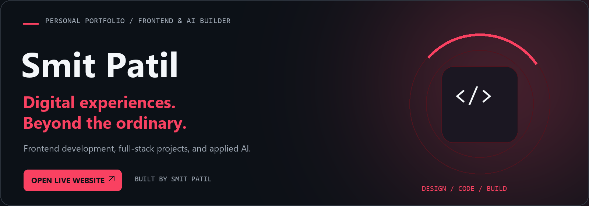
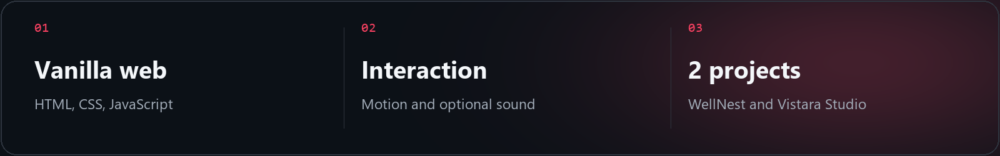

<a href="https://smit-patil-portfolio-eight.vercel.app/">

</a>

<div align="center">

**[OPEN LIVE WEBSITE](https://smit-patil-portfolio-eight.vercel.app/)** &nbsp; / &nbsp; **[EXPLORE THE PROJECTS](#featured-projects)** &nbsp; / &nbsp; **[MEET THE DEVELOPER](https://smit-patil-portfolio-eight.vercel.app/)**

</div>

# Smit Patil - Developer Portfolio

**Digital experiences beyond the ordinary.**

My personal portfolio brings together my frontend work, full-stack projects, technical interests and academic background. Built with HTML, CSS and JavaScript, it focuses on typography, motion, interaction and responsive layouts.



## The experience

| Detail | What is included |
| --- | --- |
| **Visual identity** | Vanilla Linen, Pine Lacquer and Ruby Flare; Space Grotesk, Inter and JetBrains Mono typography |
| **Entrance and scrolling** | Staggered loader, reveal animations, counters and a scroll progress indicator |
| **Desktop interactions** | Custom cursor, magnetic controls, button ripples and bento-card tilt |
| **Sound** | Synthesized interaction sounds through the Web Audio API, with a visible sound toggle |
| **Navigation** | Section links, a mobile menu and a back-to-top control |
| **Content** | About, skills, experience, projects, education and contact sections |

## Featured projects

| Project | Focus | Explore |
| --- | --- | --- |
| **WellNest** | Healthcare platform with seven role-based portals, Digital Health ID and consent-based records | [Live website](https://wellnest-healthcare.vercel.app/) / [Source](https://github.com/smitpatil1959-design/WellNest-HealthCare) |
| **Vistara Studio** | Website intelligence, AI-assisted analysis and editable presentations | [Live website](https://vistara-studio-smitpatil1959-1013s-projects.vercel.app/) / [Source](https://github.com/smitpatil1959-design/Vistara-Studio) |

## Stack

| Area | Implementation |
| --- | --- |
| Structure | HTML5 and inline SVG icons |
| Styling | CSS custom properties, responsive layouts, transitions and keyframes |
| Interaction | Vanilla JavaScript and browser APIs |
| Audio | Web Audio API |
| Typography | Google Fonts with system-font fallbacks |
| Hosting | Vercel static hosting |

No package installation or build step is required for the website.

## Run locally

```sh
git clone https://github.com/smitpatil1959-design/MyPortfolio.git
cd MyPortfolio
```

Open `index.html` in your browser, or serve the folder using a local static server. For example, with Python installed:

```sh
python -m http.server 5500
```

Then open [localhost:5500](http://localhost:5500/).

## Project structure

| File | Purpose |
| --- | --- |
| [index.html](./index.html) | Page sections, project content, metadata, navigation and contact markup |
| [style.css](./style.css) | Design tokens, layout, responsive styling and visual effects |
| [script.js](./script.js) | Loader, cursor, navigation, scroll effects, sound and interaction handlers |
| [vercel.json](./vercel.json) | Vercel project settings and clean URLs |
| `docs/readme-assets/` | Repository-hosted artwork used by this README |

## Make it your own

1. Update the profile text, education, experience and project links in `index.html`.
2. Adjust the design tokens in `style.css` to change the palette, type and spacing.
3. Tune interaction and sound behavior in `script.js`.
4. Replace contact links with your own destinations before publishing a fork.

The contact form currently shows a client-side confirmation and resets the fields. It does not send a message to an email service or backend. Use the direct email or LinkedIn links to contact me; connect a real delivery handler before treating the form as message delivery.

## Deployment

Import this repository into Vercel as a static site. Use the repository root as the site root; no build command or environment variables are required by the current implementation. The committed `vercel.json` enables clean URLs.

**Live portfolio:** [smit-patil-portfolio-eight.vercel.app](https://smit-patil-portfolio-eight.vercel.app/)

## About the developer

**Smit Patil** - Frontend Development Specialist and AI / Software Developer, based in Vadodara, India. Studying in the third year of the Diploma in Information Technology at Polytechnic, The Maharaja Sayajirao University of Baroda.

---

<p align="center">
Built by <a href="https://github.com/smitpatil1959-design"><strong>Smit Patil</strong></a><br />
Frontend Development Specialist &amp; AI / Software Developer<br /><br />
<a href="https://smit-patil-portfolio-eight.vercel.app/">Portfolio</a> &nbsp; / &nbsp;
<a href="https://www.linkedin.com/in/smitpatil2008/">LinkedIn</a>
</p>
